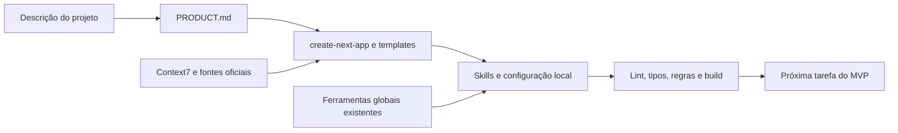

<a id="topo"></a>
<a id="sobre-o-projeto"></a>

<p align="center">
  <picture>
    <source media="(prefers-reduced-motion: reduce)" srcset="docs/assets/readme/hero-still.svg" />
    
  </picture>
</p>

# Vibe Coding Toolkit

**Sua próxima ideia começa com uma base bem preparada.**

Descreva o produto. Prepare o projeto. Comece a construir. O toolkit reúne o bootstrap Next.js, as skills e os acordos de desenvolvimento com IA — com caminhos para usar tudo ou adotar uma peça por vez.

<p align="center">
  <a href="#comece-por-aqui"><strong>INICIAR UM PROJETO →</strong></a>
  &nbsp; · &nbsp;
  <a href="docs/03-environment-setup.md">PREPARAR A MÁQUINA</a>
  &nbsp; · &nbsp;
  <a href="#documentacao-completa">EXPLORAR O TOOLKIT</a>
</p>

<p align="center">
  <strong>Next.js</strong> / TypeScript / Tailwind / ESLint
  <br />
  <strong>Claude Code + Codex</strong> / instruções portáveis / skills locais
</p>

O toolkit funciona com agentes que tenham acesso a arquivos e terminal. Os guias cobrem **Claude Code e Codex** separadamente; instruções compartilhadas também orientam outras LLMs e clientes compatíveis.

---

<a id="como-usar-este-repositorio"></a>

<a id="como-usar-este-repositório"></a>
<a id="setup-completo-com-o-projeto-aberto-no-agente"></a>

## Escolha seu ponto de entrada

<table>
  <tr>
    <td width="50%" valign="top">
      <h3>01 / Um projeto novo</h3>
      <p>Da descrição do produto à base Next.js configurada, com skills locais e checks reais.</p>
      <p><a href="docs/04-project-bootstrap.md"><strong>Abrir o bootstrap →</strong></a> · <a href="docs/prompts/11-next-project-bootstrap.md">Prompt curto</a></p>
    </td>
    <td width="50%" valign="top">
      <h3>02 / Sua máquina pronta</h3>
      <p>Prepare o ambiente global e reutilize ferramentas entre projetos, com o escopo de cada cliente.</p>
      <p><a href="docs/03-environment-setup.md"><strong>Configurar o ambiente →</strong></a> · <a href="docs/prompts/10-development-environment-setup.md">Prompt 10</a></p>
    </td>
  </tr>
  <tr>
    <td width="50%" valign="top">
      <h3>03 / Uma peça de cada vez</h3>
      <p>Escolha lint, skills, contexto ou outra ferramenta para uma necessidade concreta.</p>
      <p><a href="docs/01-installation.md"><strong>Ver a instalação →</strong></a> · <a href="docs/tools/">Ferramentas</a> · <a href="docs/prompts/">Prompts</a></p>
    </td>
    <td width="50%" valign="top">
      <h3>04 / Um projeto existente</h3>
      <p>Incorpore o fluxo e as instruções compartilhadas à base que você já tem.</p>
      <p><a href="docs/02-playbook-onboarding.md"><strong>Playbook Claude →</strong></a> · <a href="docs/tools/15-codex-workflow.md">Guia Codex</a> · <a href="templates/AGENTS.md.template">AGENTS</a></p>
    </td>
  </tr>
</table>

<a id="comece-por-aqui"></a>

## Comece um projeto com duas linhas

Abra o agente no diretório de destino e cole. Troque a segunda linha pelo seu projeto:

```text
Leia https://raw.githubusercontent.com/soumatheusgomes/vibe-coding-toolkit/main/docs/prompts/11-next-project-bootstrap.md e execute o setup neste diretório.
Projeto: [nome, problema, público, fluxos principais e restrições].
```

Exemplo: “CRM para pequenas imobiliárias, com contatos, negócios, tarefas e funil por equipe. Interface em português; primeira versão focada em cadastro e acompanhamento de oportunidades.”

O setup entrega:

- `PRODUCT.md` com MVP, restrições, hipóteses e critérios de aceitação.
- Base oficial Next.js com Drizzle/PostgreSQL, Zod, Pino, Vitest, Tailwind e ESLint.
- Skills Vercel locais, catalogadas [uma por uma](docs/tools/16-vercel-skills.md), e `skills-lock.json`.
- Quatro documentos na raiz; arquitetura, design, onboarding, qualidade e evidências em `docs/`.
- Ponytail, Caveman, Superpowers, RTK, Context7 e Graphify, reutilizando o que já está global.
- Lint, tipos, testes de fronteiras, self-check das regras, SQL e build validados.

> **Ideia → produto → base → skills → checks → MVP.**
>
> O toolkit é uma receita com templates. `create-next-app` fornece a base estável na execução. Drizzle/PostgreSQL é o padrão de persistência; autenticação e serviços entram conforme o produto. Os [defaults](docs/06-project-defaults.md) são revistos com fontes atuais em cada setup.

Não instala travas de push em `main`, não exige branch e não adiciona hooks de commit/push. Instalar skills de deploy não publica a aplicação. Veja [o fluxo completo](docs/04-project-bootstrap.md) para escopos e validação.

**Base verificada em macOS, Linux e Windows.** Lint, tipos, regras, build e HTTP fazem parte da [validação reproduzível](docs/05-toolkit-validation.md); o relatório também registra limites e riscos conhecidos.

---

## Global e local

| Máquina e cliente | Projeto |
|---|---|
| Runtime, Git e gerenciador | Next, React, TypeScript, Tailwind e ESLint |
| Agente, autenticação e plugins | Produto, comandos e instruções compartilhadas |
| RTK e integração funcional | Skills Vercel, `find-skills` e lockfile |
| Ponytail, Caveman e Superpowers | Regras de lint e exclusões Graphify |
| Graphify e conexão Context7 existente | Configuração MCP local, se faltar conexão |

Cada cliente tem formatos e descoberta próprios. Não copie configurações Claude para Codex. O [setup da máquina](docs/03-environment-setup.md) cuida da instalação global; o [bootstrap](docs/04-project-bootstrap.md) evita refazê-la por projeto.

<a id="ou-só-o-eslint-numa-linha"></a>

## Adote uma peça por vez

Para instalar somente o teto de 350 linhas e os quality gates:

```text
Leia https://raw.githubusercontent.com/soumatheusgomes/vibe-coding-toolkit/main/docs/prompts/08-eslint-quality-gates-install.md e execute o prompt neste projeto. Use MAX_LINES=350.
```

Depois da medição, use [o prompt 09](docs/prompts/09-file-size-refactor.md) para refatorar arquivos grandes. Para instalar apenas skills Vercel, use [o catálogo](docs/tools/16-vercel-skills.md). Esses caminhos não exigem todo o bootstrap.

<a id="o-fluxo-completo"></a>

## Fluxo



<a id="superpowers-primeiro"></a>

Superpowers orienta o processo. Ponytail limita escopo e código desnecessário. Caveman mantém conversa concisa. RTK reduz saídas suportadas. Context7 consulta APIs atuais; Graphify ajuda a navegar a estrutura. Skills Vercel orientam React/Next, componentes, UI, escrita e operações específicas.

Delegue quando houver benefício e suporte, com tarefas independentes e responsabilidade por arquivo. Mudanças pequenas podem seguir no agente principal. Preserve cliente, modelo e autenticação da sessão; ferramentas não autorizam troca de provedor ou billing de API silencioso.

<a id="documentacao-completa"></a>

<a id="documentação-completa"></a>
<a id="índice"></a>

## Referências

A raiz tem a apresentação e as instruções dos agentes. `docs/` reúne guias, `docs/tools/` as ferramentas, `docs/prompts/` os prompts e `templates/` os arquivos reutilizáveis. `scripts/` contém somente a validação. Os caminhos públicos existentes foram preservados.

<a id="fundamentos"></a>

### Guias

| Documento | Uso |
|---|---|
| [Visão geral](docs/00-overview.md) | Princípios |
| [Instalação](docs/01-installation.md) | Comandos e escopos |
| [Playbook Claude](docs/02-playbook-onboarding.md) | Projeto existente |
| [Ambiente global](docs/03-environment-setup.md) | Preparação e reprodução da máquina |
| [Bootstrap Next](docs/04-project-bootstrap.md) | Produto até base configurada |
| [Padrões do projeto](docs/06-project-defaults.md) | Stack, documentos e atualização com fontes atuais |
| [Validação do toolkit](docs/05-toolkit-validation.md) | Checks reproduzíveis e limites comprovados |

### Ferramentas

[Catálogo de ferramentas](docs/tools/README.md): fluxo e agentes, qualidade, contexto, automação e integrações opcionais.

<a id="prompts-prontos"></a>

### Prompts

[Catálogo de prompts](docs/prompts/README.md): setup, adoção parcial e manutenção.

### Templates

[Catálogo de templates](templates/README.md): documentação, núcleo Next, ESLint e configurações por cliente. Copie apenas a peça usada; preencha os documentos e valide a configuração no destino.

<a id="creditos"></a>
<a id="licenca"></a>
<a id="vamos-juntos"></a>

<a id="créditos"></a>
<a id="licença"></a>

## Créditos e licença

Fontes: [Superpowers](https://github.com/obra/superpowers), [RTK](https://github.com/rtk-ai/rtk), [Ponytail](https://github.com/DietrichGebert/ponytail), [Caveman](https://github.com/JuliusBrussee/caveman), [Graphify](https://github.com/Graphify-Labs/graphify), [Context7](https://github.com/upstash/context7), [agent-browser](https://github.com/vercel-labs/agent-browser), [Vercel Agent Skills](https://github.com/vercel-labs/agent-skills) e [Skills CLI](https://github.com/vercel-labs/skills). Cada ferramenta mantém sua licença e distribuição.

Toolkit sob [MIT](LICENSE). Por [Matheus Gomes](https://instagram.com/matheusgomes). [Issues e PRs](https://github.com/soumatheusgomes/vibe-coding-toolkit).

<p align="center">
  <strong>BUILD WITH INTENT. SHIP WITH FLOW.</strong>
  <br />
  <a href="#topo">Voltar ao topo ↑</a>
</p>
